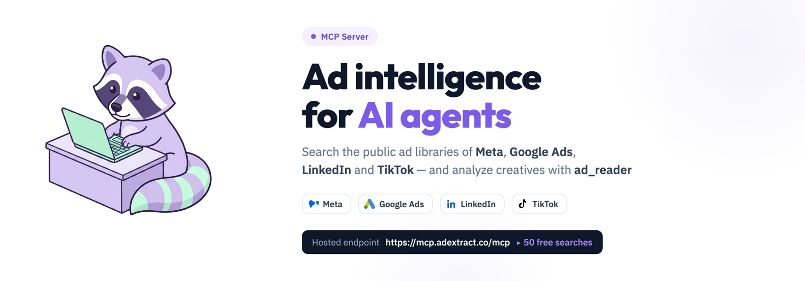
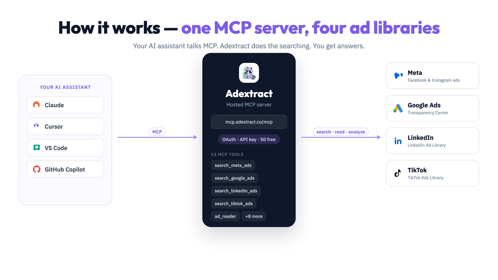

# Adextract MCP Server

[](https://modelcontextprotocol.io/)
[](LICENSE)

<p align="center">
  
</p>

Adextract is an MCP (Model Context Protocol) server that gives AI assistants ad intelligence. It searches the ad libraries of **Meta** (Facebook and Instagram), **Google Ads**, **LinkedIn**, and **TikTok**, and analyzes ad creatives with `ad_reader`.

**Hosted endpoint:** `https://mcp.adextract.co/mcp`
**Free tier:** 50 free searches. Get an API key at [adextract.co](https://adextract.co).

> ⭐ If Adextract helps you, star this repo. It helps other AI developers find it.

---

## Watch the demo

<video src="assets/adextract-demo.mp4" poster="assets/adextract-demo-poster.png" controls width="100%" style="max-width: 720px; border-radius: 16px;"></video>

*Also on [YouTube](https://youtu.be/GjhLeqV3zx8).*

---

## How it works

One MCP server, one API key, four ad libraries. Your AI assistant talks MCP — Adextract does the searching and analyzing.

<p align="center">
  
</p>

---

## Quickstart

1. Get a free API key at [adextract.co](https://adextract.co) (account → API keys).
2. Add the server to Cursor with the config below.
3. Ask your AI: *"Show me Nike's active Facebook ads in the US"*.

There is nothing to install locally. Adextract runs as a hosted MCP server, so it works in any MCP-capable client.

---

## Use cases

- **Competitor ad intelligence** - see what your competitors are running across Meta, Google, LinkedIn, and TikTok.
- **Creative analysis** - `ad_reader` breaks any ad creative into format, audience, emotion, and archetypes.
- **Brand monitoring** - track ads for any brand or domain across four ad libraries.
- **Channel strategy** - built-in MCP prompts turn ad data into channel plans.

---

## Installation

### Hosted MCP (recommended)

Connect to the Adextract hosted server:

```
https://mcp.adextract.co/mcp
```

Get your API key at [adextract.co](https://adextract.co) (account → API keys).

### Cursor

Add to `~/.cursor/mcp.json` or project `.cursor/mcp.json`:

```json
{
  "mcpServers": {
    "ad-extract": {
      "url": "https://mcp.adextract.co/mcp",
      "headers": {
        "Authorization": "Bearer YOUR_API_KEY"
      }
    }
  }
}
```

### VS Code

Add to `.vscode/mcp.json`:

```json
{
  "servers": {
    "ad-extract": {
      "type": "http",
      "url": "https://mcp.adextract.co/mcp",
      "headers": {
        "Authorization": "Bearer YOUR_API_KEY"
      }
    }
  }
}
```

### Claude Web (OAuth)

1. Open Claude → **Settings** → **Connectors** → **Add custom connector**
2. Name: `ad-extract`
3. URL: `https://mcp.adextract.co/mcp`
4. Sign in and approve when prompted (no API key in the URL).

### Claude Desktop (`mcp-remote`)

```json
{
  "mcpServers": {
    "ad-extract": {
      "command": "npx",
      "args": [
        "-y",
        "mcp-remote",
        "https://mcp.adextract.co/mcp",
        "--header",
        "Authorization: Bearer ***"
      ]
    }
  }
}
```

More clients and config paths: [docs/CLIENT_SETUP.md](docs/CLIENT_SETUP.md)

---

## Available Tools

| Tool | Platform | Description |
|------|----------|-------------|
| `search_meta_ads` | Meta | Search Facebook & Instagram ads |
| `search_meta_pages` | Meta | Discover pages and location IDs |
| `get_meta_page_info` | Meta | Page transparency and metadata |
| `get_meta_ad_details` | Meta | EU/UK ad transparency details |
| `search_google_ads` | Google | Google Ads Transparency Center |
| `search_google_ads_advertisers` | Google | Advertiser and domain search |
| `get_google_ad_details` | Google | Creative details |
| `get_google_ads_advertiser_info` | Google | Advertiser profile from Search ads |
| `search_linkedin_ads` | LinkedIn | LinkedIn Ad Library |
| `search_tiktok_ads` | TikTok | TikTok Ads Library |
| `search_tiktok_advertisers` | TikTok | TikTok advertiser discovery |
| `get_tiktok_ad_details` | TikTok | Targeting and creative details |
| `ad_reader` | All | Analyze image/video creatives (format, audience, emotion, archetypes) |

Full reference: [docs/TOOLS.md](docs/TOOLS.md)

---

## Prompts & Resources

Built-in MCP prompts for common workflows:

- `adextract_top_ads_for_brand`
- `adextract_competitor_benchmark`
- `adextract_channel_strategy`
- `adextract_analyze_ad_url`
- `adextract_schedule_watchlist`

Resources include agent skill instructions and prompt-pack references (`adextract://skill/main`, etc.).

---

## Authentication

| Method | Best for |
|--------|----------|
| **OAuth 2.0** | Claude Web and OAuth-capable connectors |
| **Bearer API key** | Cursor, VS Code, Claude Desktop, `mcp-remote` |

Discovery endpoints:

- `https://mcp.adextract.co/.well-known/oauth-protected-resource`
- `https://mcp.adextract.co/.well-known/oauth-authorization-server/oauth`

Server card (registry / client discovery):

- `https://mcp.adextract.co/.well-known/mcp.json`

---

## Example prompts

```
Show me the latest Nike ads on Facebook in the US.
→ search_meta_ads({ q: "nike", country: "US", active_status: "active" })

Find Google ads for tesla.com from the last 30 days.
→ search_google_ads({ domain: "tesla.com", time_period: "last_30_days" })

Analyze this ad creative URL with ad_reader.
→ ad_reader({ url: "https://..." })
```

---

## FAQ

### What is Adextract?

Adextract is a hosted MCP server that lets AI assistants search the public ad libraries of Meta, Google Ads, LinkedIn, and TikTok, and analyze ad creatives. It works with Claude, Cursor, VS Code, and any MCP-capable client.

### Which ad libraries does it cover?

Meta Ad Library (Facebook and Instagram), Google Ads Transparency Center, LinkedIn Ad Library, and TikTok Ads Library.

### How do I get an API key?

Sign up at [adextract.co](https://adextract.co), then go to account → API keys. The key is shown once at creation.

### Is there a free tier?

Yes. New accounts get 50 free searches. Paid plans are available at [adextract.co](https://adextract.co).

### What does `ad_reader` do?

It analyzes any public image or video ad creative and returns structured JSON: format, target audience, emotion (Plutchik/VAD), archetypes, and industry/brand.

### Do I need to run any code locally?

No. Adextract is a hosted server. You only add a config entry to your client.

### Can I use OAuth instead of an API key?

Yes. Claude Web and other OAuth-capable connectors can sign in directly, with no API key in the URL. Other clients use a Bearer API key.

### How is this different from querying the ad libraries directly?

Each ad platform has its own library, API, and access rules. Adextract gives one MCP interface across all four, plus creative analysis, without writing platform-specific code.

---

## Documentation

| Doc | Purpose |
|-----|---------|
| [docs/CLIENT_SETUP.md](docs/CLIENT_SETUP.md) | Per-client configuration |
| [docs/TOOLS.md](docs/TOOLS.md) | Tools, prompts, resources |
| [docs/TROUBLESHOOTING.md](docs/TROUBLESHOOTING.md) | Common errors and fixes |
| [REGISTRY_CHECKLIST.md](REGISTRY_CHECKLIST.md) | Pre-submission checklist |
| [SECURITY.md](SECURITY.md) | Security policy |
| [SUPPORT.md](SUPPORT.md) | How to get help |

---

## Links

- **Website:** [adextract.co](https://adextract.co)
- **MCP endpoint:** `https://mcp.adextract.co/mcp`
- **Repository:** [github.com/ad-vertly/adextract-mcp-server](https://github.com/ad-vertly/adextract-mcp-server)

---

<p align="center">
  
  <br>
  <sub>Built with ❤️ by <a href="https://adextract.co">Adextract</a></sub>
</p>
